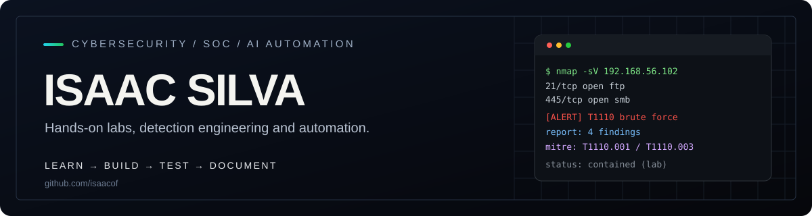

# Hi, I'm Isaac Silva

I'm beginning my programming journey, with an interest in **artificial intelligence, data, automation and Cybersecurity**.

My goal is to turn ideas into small, understandable projects and document what I learn along the way.

## Current focus

- Strengthening my programming foundations.
- Learning to organize and maintain projects with Git and GitHub.
- Preparing my first AI project with a clear, manageable scope.

## What I want to explore

| Area | My interests |
| --- | --- |
| Artificial intelligence | Practical applications, useful answers and evaluating results |
| Data | Understanding datasets and presenting information clearly |
| Automation | Reducing repetitive work and making processes easier to follow |

## How I want to build

**Understand the problem → Build a small version → Test it → Document what I learned.**

I want each project to explain what it does, how to run it, its current limitations and the next steps. Work in progress will be clearly identified.

## Projects

I'm preparing my first AI project. I'll add a link here when I have something ready to share.

The forked repositories on my profile are learning references or starting points from their original authors. Any contributions I make will be documented separately.
